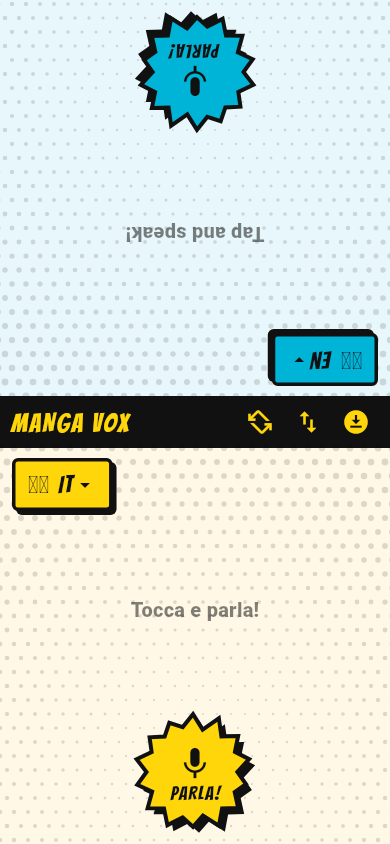
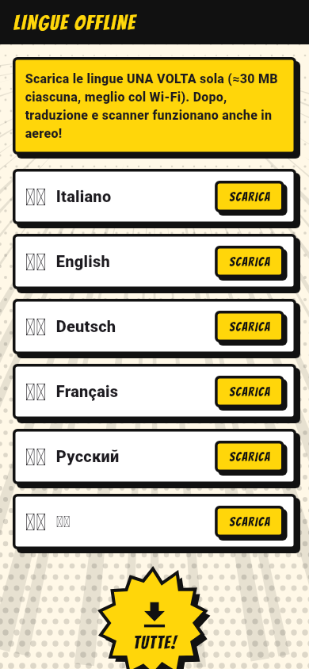

# 💥 Manga Vox: traduttore offline in stile fumetto

App per **iPhone e Android** di traduzione simultanea **offline**, pensata per dialoghi veloci tra due persone, con **scanner di testo da foto** e traduzione in tempo reale. Grafica manga/fumetto action.

**Lingue:** 🇮🇹 Italiano · 🇬🇧 Inglese · 🇩🇪 Tedesco · 🇫🇷 Francese · 🇷🇺 Russo · 🇨🇳 Cinese

<p>




</p>

## Come si usa (pochi pulsanti)

### 🗣 DIALOGO
1. Metti il telefono sul tavolo tra te e l'altra persona. La metà in alto è capovolta per chi ti sta di fronte.
2. Ognuno sceglie la sua lingua (bandierina).
3. Tocca **PARLA!** e parla. L'app riconosce la voce, traduce e **legge ad alta voce** la traduzione all'altro.
4. Poi l'altra persona tocca il suo **PARLA!** e risponde.

Pulsanti nella barra centrale: ↻ faccia a faccia / fianco a fianco · ⇅ scambia lingue · ⬇ lingue offline.

### 📷 SCANNER
- **LIVE**: inquadra un cartello, un menù o un documento e la traduzione compare subito in basso.
- **SCATTA!**: fotografa e ottieni la traduzione completa blocco per blocco (copia o ascolta).
- **FOTO**: traduci un'immagine dalla galleria.

## Come funziona offline

| Funzione | Tecnologia (tutto sul dispositivo) |
|---|---|
| Traduzione | Google ML Kit On-Device Translation (modelli da ~30 MB per lingua, scaricati **una volta sola**) |
| Testo da foto: IT/EN/DE/FR/ZH | Google ML Kit Text Recognition v2 (latino + cinese), anche dal vivo |
| Testo da foto: RU (cirillico) | Android: Tesseract (dati inclusi nell'app) · iOS: Apple Vision (iOS 16+). Solo con SCATTA!/FOTO |
| Voce → testo | Riconoscimento vocale del sistema in modalità *on-device* |
| Testo → voce | Sintesi vocale del sistema (TTS) |

> **Primo avvio:** l'app apre la schermata *Lingue offline*. Premi **TUTTE!** con il Wi-Fi: dopo, la traduzione funziona anche in aereo.
>
> **Voce offline:** il riconoscimento vocale offline usa i pacchetti lingua del telefono.
> - Android: Impostazioni › Sistema › Lingua › *Riconoscimento vocale offline* (o app Google › Voce), scarica le lingue.
> - iPhone: Impostazioni › Generali › Tastiera › attiva *Dettatura*; le lingue con dettatura sul dispositivo funzionano offline.
>
> Se il pacchetto offline manca, l'app lo segnala e usa il riconoscimento standard del sistema.

## Struttura del progetto

```
lib/
  main.dart                  App, tab DIALOGO / SCANNER, primo avvio
  languages.dart             Le 6 lingue (codici ML Kit, voce, OCR)
  services/
    translator_service.dart  Traduzione offline + download modelli
    voice_service.dart       Voce→testo (on-device) e testo→voce
    ocr_service.dart         OCR: ML Kit + canale nativo per il russo
    prefs.dart               Memorizza le lingue scelte
  screens/
    dialog_screen.dart       Dialogo a due metà schermo
    scanner_screen.dart      Fotocamera, traduzione LIVE, scatto
    scan_result_screen.dart  Risultato della foto
    languages_screen.dart    Download pacchetti lingua
  ui/manga.dart              Grafica fumetto: retino, linee cinetiche, nuvolette, pulsanti "esplosione"
android/…/MainActivity.kt    OCR russo con Tesseract4Android
ios/Runner/AppDelegate.swift OCR russo con Apple Vision
assets/icon/                 Icona (generate_icon.py la ridisegna)
```

## Compilare

Requisiti: [Flutter](https://docs.flutter.dev/get-started/install) 3.38 o successivo, Android Studio (per Android), Mac con Xcode 16+ e CocoaPods (per iOS).

```bash
flutter pub get
dart run flutter_launcher_icons   # rigenera le icone (già incluse)
flutter run                       # su telefono collegato
flutter test                      # test
```

Requisiti minimi: **Android 7.0 (API 24)** · **iOS 15.5** (lettura del russo da foto: iOS 16).
La fotocamera e il microfono vanno provati su un **telefono vero**: l'emulatore non basta.

## Pubblicare sugli store

### Google Play
1. Crea la chiave di firma (una volta sola, **conservala**):
   ```bash
   keytool -genkey -v -keystore ~/manga-vox-upload.jks -keyalg RSA -keysize 2048 -validity 10000 -alias upload
   ```
2. Crea `android/key.properties` (non viene caricato su git):
   ```properties
   storePassword=…
   keyPassword=…
   keyAlias=upload
   storeFile=/percorso/manga-vox-upload.jks
   ```
3. `flutter build appbundle --release` → carica `build/app/outputs/bundle/release/app-release.aab` su [Play Console](https://play.google.com/console) (account sviluppatore: 25 $ una tantum).
4. Nella scheda *Sicurezza dei dati*: nessun dato raccolto né condiviso (vedi [PRIVACY.md](PRIVACY.md)). Permessi: microfono, fotocamera.

### App Store (iPhone)
1. Serve un account [Apple Developer](https://developer.apple.com/programs/) (99 $/anno) e un Mac.
2. `cd ios && pod install`, poi apri `ios/Runner.xcworkspace` in Xcode → *Signing & Capabilities* → scegli il tuo Team.
   Se `com.morelli.mangaVox` è già preso, cambia il Bundle ID.
3. `flutter build ipa --release` → carica con l'app *Transporter* o da Xcode (*Product › Archive*).
4. Su [App Store Connect](https://appstoreconnect.apple.com): privacy *Data Not Collected*, link alla privacy policy (pubblica il testo di [PRIVACY.md](PRIVACY.md), per esempio su GitHub Pages).

**Testi per lo store (suggeriti)**
- Nome: *Manga Vox: Traduttore Offline*
- Sottotitolo: *Parla, scatta, traduci senza rete*
- Descrizione breve: *Traduttore vocale e scanner di testo offline in stile fumetto: italiano, inglese, tedesco, francese, russo e cinese.*

## Licenze
- Font **Bangers**: SIL Open Font License (`assets/fonts/OFL-Bangers.txt`).
- Dati OCR russi: `tessdata_fast` di Tesseract (Apache 2.0).
- Modelli di traduzione e OCR: Google ML Kit (termini di servizio ML Kit).
